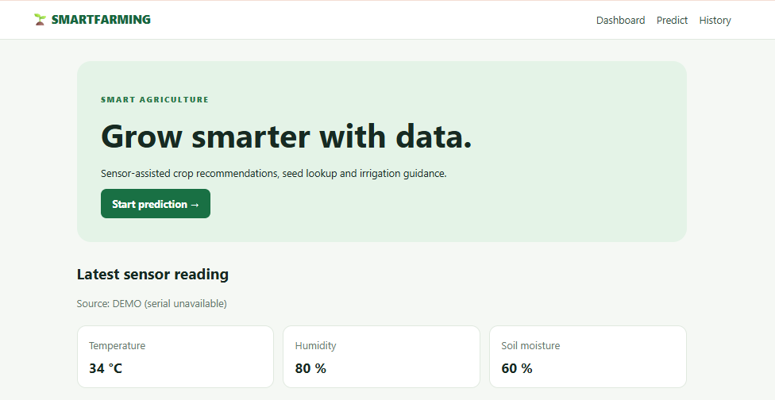
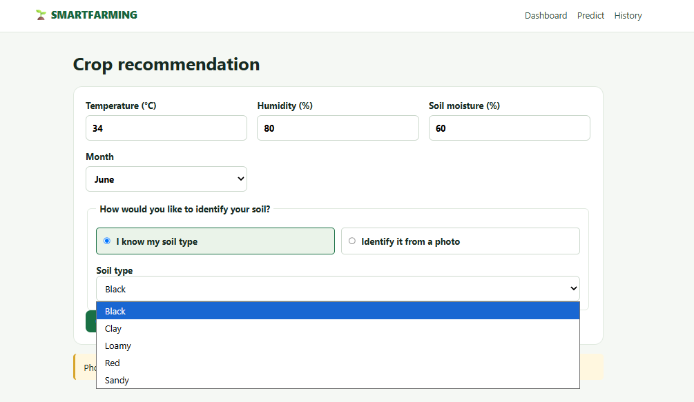
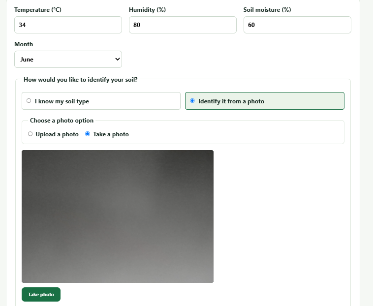
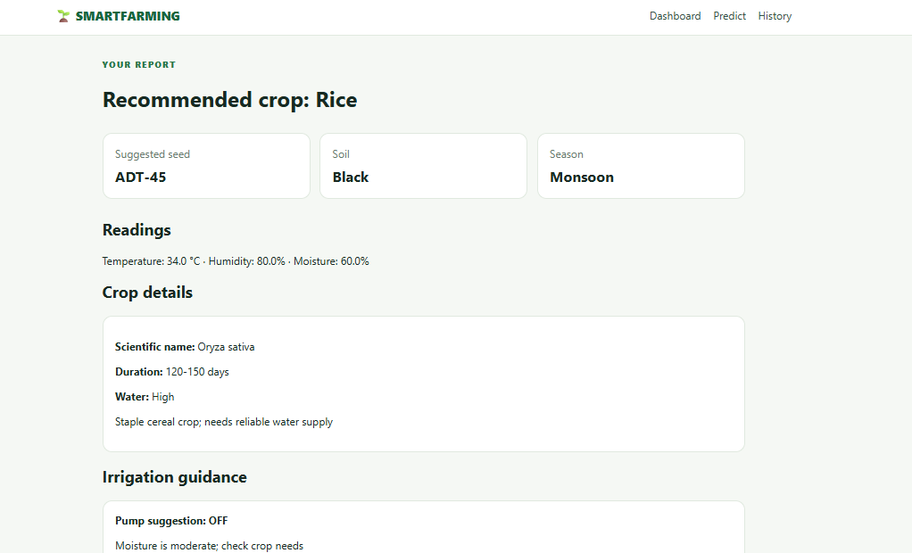
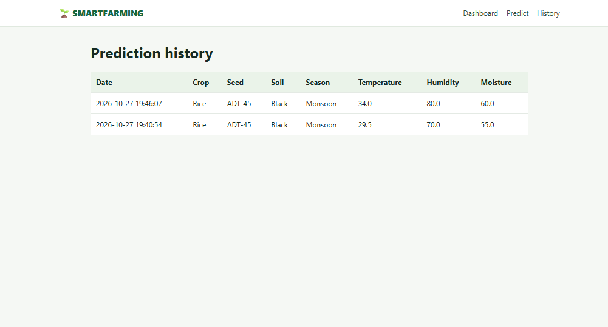

# Smart_Farming_System

Smart Farming System is a web-based agriculture application designed to help farmers make informed decisions using machine learning, sensor data, and soil analysis. The system provides crop recommendations based on environmental conditions and soil characteristics, helping users explore suitable crops and seeds for different growing seasons.

The application is developed using Python, Flask, Machine Learning, HTML, CSS, JavaScript, and ESP32/Arduino. It combines a user-friendly web interface with agricultural datasets and sensor readings to demonstrate how technology can support modern farming practices.
## 📸 Application Screenshots

### 1. Home Page

### 2. Pridiction_By_Known Soil-Type

### 3. Pridiction_By_UnKnown Soil-Type

### 4. Recommendation_Page

### 5. History_Page
